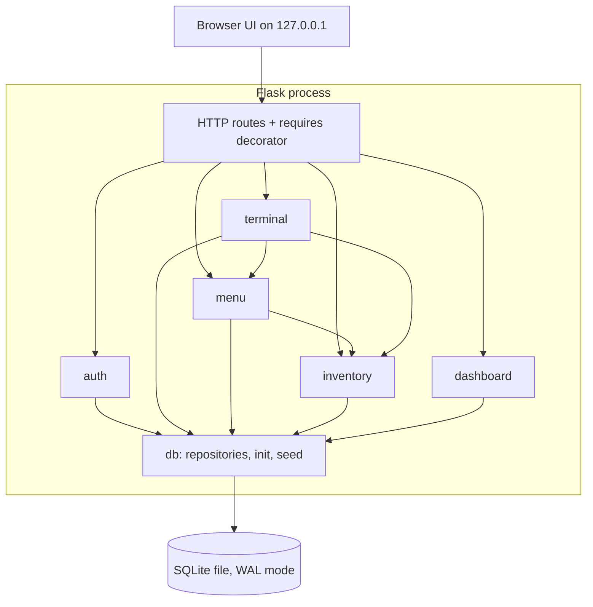
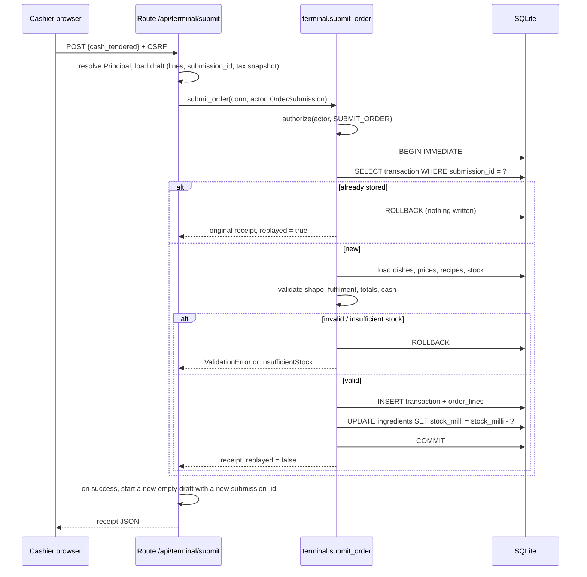
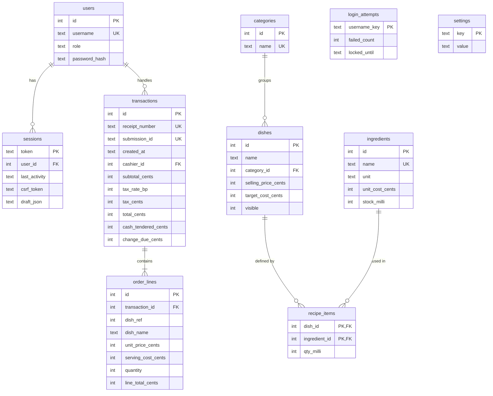

# Design Document: Restaurant POS System

## Overview

The Restaurant POS System is a standalone, fully offline point-of-sale application. One process runs on the restaurant's machine, serves a browser-based UI on the loopback interface only (`127.0.0.1`), and keeps all data in a single SQLite file. There is no remote dependency at runtime: no CDN assets, no web fonts, no cloud APIs.

Two roles exist. Cashiers use the POS Terminal and the Available Menu List. The Owner also manages categories, dishes, ingredients, recipes, pricing and tax, and reviews the Dashboard and Transaction Log. Role checks are enforced on the server, in the service layer and again in the HTTP layer, independent of which links the UI shows.

### Technology Stack and Justification

| Concern | Choice | Why |
|---|---|---|
| Language / runtime | Python 3.12 | Already installed on the target machine (verified: Python 3.12.0; Node 22 also present). Standard library covers SQLite, hashing (`hashlib.scrypt`), UUIDs, dates and exact arithmetic. |
| Database | SQLite via stdlib `sqlite3` | Zero-install, single file, ACID transactions, transactional DDL, `CHECK`/`FOREIGN KEY`/`UNIQUE` constraints as a second line of defence. Matches the "Local_Database (for example SQLite)" wording. |
| Web layer | Flask 3 (brings Jinja2 and Werkzeug) | Small, well known, server-side rendering means role checks happen before any HTML is produced (Req 4.6). Only one third-party runtime dependency. |
| Front end | Server-rendered Jinja templates, plain CSS, ~150 lines of vanilla JS | No bundler, no Node toolchain, no CDN. JS is used only for terminal interactions and 2-second polling. |
| Chart | Server-generated inline SVG | No chart library to vendor. The SVG is built from the same bucket data that is asserted in tests (Req 17.5). |
| Password hashing | `hashlib.scrypt` with a per-user random 16-byte salt, `hmac.compare_digest` | Stdlib, salted, one-way (Req 2.2). |
| Tests | `pytest` + `Hypothesis` | Hypothesis is the standard Python property-based testing library (Req 19.6). Not implemented from scratch. |

Why not Node or Electron: Node 22's built-in `node:sqlite` is still flagged experimental, there is no native decimal type, and Electron adds a large packaging burden. Python gives a stable SQLite driver with no native compilation step.

How to run (one command each, satisfying Req 19.2 to 19.6):

```
python -m venv .venv && .venv\Scripts\activate
pip install -r requirements.txt          # one-time; needs internet, or use: pip install --no-index --find-links vendor -r requirements.txt
python -m pos init-db                     # create schema
python -m pos seed-db                     # load Seed_Data
python -m pos run                         # start on http://127.0.0.1:5000
python -m pytest                          # all tests, exit code 0 only if all pass
```

Installing dependencies is a one-time setup step. After that, the running application never touches the network. For a machine that never has internet, `pip download -r requirements.txt -d vendor` on another machine produces an offline wheel folder.

### Key Design Decisions

1. **Exact arithmetic with scaled integers, not floats.** Money is stored as integer cents. Stock and recipe quantities are stored as integer milli-units (x1000), which represents 2-decimal stock and 3-decimal recipe quantities exactly. Tax rate is stored in basis points (hundredths of a percent). Round-half-up is implemented with integer math, e.g. `(subtotal * bp + 5000) // 10000`. See Data Models.
2. **Availability is derived, not stored.** `Availability_Status` is a pure function of a Dish's recipe and current stock, computed on every read. It can never be stale, so Req 11.3 and 11.4 hold by construction. If the computation raises, the dish is treated as unavailable and an error is surfaced (Req 11.9).
3. **Services are the enforcement point.** Every service function takes an `actor` and calls `authorize(actor, permission)` first. Flask routes also use a `@requires(permission)` decorator so screens are blocked before rendering. Tests call services directly to prove that "direct operation calls" are rejected (Req 4.4).
4. **One write path, one lock.** Every mutation runs inside `BEGIN IMMEDIATE ... COMMIT`. SQLite allows exactly one write transaction at a time, so concurrent submissions are serialized in arrival order and each sees the stock left by the previous one (Req 7.9). See [SQLite transaction docs](https://www.sqlite.org/lang_transaction.html) for IMMEDIATE semantics: the transaction takes the write lock at `BEGIN`, and waits or fails with `SQLITE_BUSY` if another writer is active. Content was rephrased for compliance with licensing restrictions.
5. **The draft Order lives on the server.** It is stored on the session row, so it survives navigation to the Available Menu List (Req 5.12) and page reloads, and the server can re-validate it.
6. **Historical data is snapshotted.** Order lines store dish name, selling price and serving cost at the moment of sale. Transactions store the tax rate used. Nothing in history joins back to live menu data (Req 7.3, 9.8, 13.5, 13.7, 14.3, 16.7).
7. **Injectable clock.** Every time-dependent service takes `now` from a `Clock` callable. Tests control time for session expiry, login lockout, date filters and seed data.

### Research Findings That Informed the Design

- SQLite supports many concurrent readers and one writer. `BEGIN IMMEDIATE` acquires the write lock up front, so check-then-write sequences (idempotency lookup, stock check, insert, deduct) cannot interleave with another writer ([SQLite docs](https://www.sqlite.org/lang_transaction.html)). This removes the need for application-level locks.
- SQLite DDL is transactional, so the initialization script can run entirely inside one transaction and roll back cleanly on failure (Req 1.7).
- Python's `sqlite3` module in default mode opens implicit transactions. The design opens connections with `isolation_level=None` and issues explicit `BEGIN IMMEDIATE`/`COMMIT`/`ROLLBACK` so transaction boundaries are visible in code.
- Hypothesis function-scoped pytest fixtures are not reset between generated examples. Property tests therefore build a fresh in-memory database inside the test body rather than using a function-scoped fixture.

## Architecture

### Layering and Modules

Requirement 19.1 demands six modules, each in its own directory, with no file in more than one module.

```
pos/
  __main__.py, cli.py, app.py, config.py   # composition root (belongs to no module)
  money.py, errors.py, clock.py, validation.py   # dependency-free kernel (pure helpers)
  auth/         # passwords, login throttling, sessions, RBAC matrix, login/logout routes
  terminal/     # draft order, checkout math, submission service, POS routes
  inventory/    # ingredients, recipes, costing, availability, Recipe and Pricing Linker routes
  menu/         # categories, dishes, tax rate, Available_Menu_List queries, Menu Management routes
  dashboard/    # date ranges, overview, top dishes, chart, Transaction_Log, Dashboard routes
  db/           # connection, schema.sql, init, seed, repositories (SQL lives here only)
  templates/, static/   # assets (no code modules)
tests/
  unit/, properties/, integration/
docs/README.md
```

The root files are the composition root (CLI, Flask app factory, config) and a small kernel of pure helpers (money, errors, clock, validation). They are not feature modules and contain no business rules beyond formatting and parsing primitives.

Dependency rule, enforced by an import-linter style test: `terminal -> menu -> inventory -> db`, and `dashboard -> db`. Every feature service also imports `auth.rbac` for `authorize`. `auth -> db`. No cycles. All SQL is in `db/` repositories, so services are testable against a plain connection.



### Request Lifecycle

1. The `before_request` hook resolves the session cookie to a `sessions` row, rejects it if idle for 30 minutes or more, loads the user and role **from the database** (never from the cookie), and builds a `Principal`.
2. `@requires(permission)` calls `authorize(principal, permission)`. No session leads to a redirect to `/login`. A session without the permission leads to a 403 access-denied page (Cashier session stays active, Req 4.3). This happens before any template is rendered.
3. The route calls a service function, passing the `Principal` and a per-request connection. The service calls `authorize` again, opens `BEGIN IMMEDIATE` if it writes, and commits or rolls back.
4. Non-safe methods also require a per-session CSRF token (header `X-CSRF-Token` or hidden form field), and the session cookie is `HttpOnly; SameSite=Strict`. The server binds to loopback only, so there is no network exposure, but authentication is still required for every screen.

Background polling endpoints (`/api/.../available`, `/api/terminal/catalog`) do not refresh `last_activity`. Only user activity (click, key press, navigation) does: navigation requests touch the session server-side, and the JS posts a debounced `POST /session/activity` (at most once per 60 seconds) on click or key press. This matches the definition in Req 3.9, where polling must not keep an abandoned session alive.

### Order Submission Sequence



### Order Submission Identifier (new term)

The requirements use "Order submission identifier" in 7.8 and 7.10 but the glossary does not define it. This design adds the following glossary entry:

> **Order_Submission_Identifier**: A random UUID (version 4, 36-character string) generated by the server when a new, empty draft Order is started. It identifies one checkout attempt of one Order. It stays constant while the Cashier edits lines, clears the order, retries after a rejected submission, or double-clicks submit. It is replaced by a new value only after a receipt has been displayed (Req 7.8). It is stored on the resulting Transaction in a `UNIQUE NOT NULL` column, and the uniqueness check runs inside the same write transaction as the insert, so two concurrent submissions with the same identifier produce exactly one Transaction (Req 7.10).

Replay semantics: a submission whose identifier already belongs to a stored Transaction returns that Transaction's receipt and writes nothing, regardless of the payload in the repeated request. Replay is checked before validation so a retry after a lost response always gets the original receipt.

### Requirement Gaps and Ambiguities Resolved by This Design

| Topic | Issue | Resolution |
|---|---|---|
| Gross_Sales definition | The glossary says Gross_Sales is the sum of **Total** (tax included). Req 15.6 says sum of **selling price x quantity** (tax excluded). They differ when Tax_Rate > 0. | The design follows Req 15.6 (operative acceptance criterion; collected tax is not revenue): `gross(t) = t.subtotal_cents`, implemented in exactly one function `gross_of_transaction`. Switching to Total is a one-line change. **Recommend correcting the glossary.** |
| Order submission identifier | Not in glossary. | Defined above. |
| Target_Cost on Dish creation | Req 13.1 creates a Dish without Target_Cost, Req 10.1 includes it. | Target_Cost defaults to 0.00 on creation and is editable in the Recipe and Pricing Linker (and accepted by `save_dish`). |
| Where tax rate is edited | Req 14 has no screen, Req 4.2 fixes exactly six nav links. | Tax rate form sits on the Menu Management screen (Owner only). |
| Stock limit for shared ingredients | Req 5.5/5.8 bound each line by its own dish's stock, Req 7.5 checks all lines together. | Terminal checks per line (friendly early feedback). Submission re-checks the aggregate requirement per ingredient and is authoritative. |
| Dish changed between checkout and submit | Price could change after the Checkout_Screen was opened. | Tax **rate** is snapshotted at checkout open (Req 14.5). Prices and recipes are read at submission time (Req 7.3). The receipt is authoritative, and `Cash_Tendered >= Total` is validated against the submission-time Total. |
| Timestamp storage | Req 7.1 requires local time to the second. | Stored as local ISO-8601 text `YYYY-MM-DD HH:MM:SS`. Range filters use string comparison on `[start, next_day_start)`. The one-hour ambiguity at a DST fall-back is accepted. |
| Password change | Not required. | Out of scope. Seeded demo passwords are documented in `docs/README.md` with a note to replace them before real use. |

## Components and Interfaces

All interfaces are Python signatures. `conn` is a per-request `sqlite3.Connection`. `actor` is a `Principal(user_id, username, role)`.

### Kernel (pure helpers)

```python
# money.py  (all values are int cents unless noted)
def parse_money(text: str, *, min_cents: int, max_cents: int) -> int   # strict grammar ^\d{1,6}(\.\d{1,2})?$ ; raises ValidationError
def format_cents(cents: int) -> str                                  # "1234.50", "-5.00", always 2 decimals, no separators
def round_half_up_div(numerator: int, denominator: int) -> int       # non-negative ints
def tax_cents(subtotal_cents: int, tax_rate_bp: int) -> int          # (subtotal*bp + 5000)//10000
def parse_quantity_milli(text: str, *, max_decimals: int, max_milli: int, allow_zero: bool) -> int
def format_milli(milli: int, decimals: int) -> str
# errors.py
class PosError(Exception); ValidationError(fields: dict[str, str]); Unauthenticated; PermissionDenied
class NotFound; Conflict(code, detail); InsufficientStock(dish_names: list[str]); StorageError
class LoginLocked(until); LoginUnavailable; DatabaseStartupError(path, reason)
# clock.py
Clock = Callable[[], datetime]        # naive local time; default datetime.now
```

### auth

```python
class Role(str, Enum): OWNER="owner"; CASHIER="cashier"
class Permission(str, Enum):
    VIEW_TERMINAL, BUILD_ORDER, SUBMIT_ORDER, VIEW_AVAILABLE_MENU,
    VIEW_MENU_MANAGEMENT, MANAGE_CATEGORIES, MANAGE_DISHES, MANAGE_TAX_RATE,
    MANAGE_INGREDIENTS, MANAGE_RECIPES, VIEW_DASHBOARD, VIEW_TRANSACTION_LOG

ROLE_PERMISSIONS: dict[Role, frozenset[Permission]]   # cashier = {VIEW_TERMINAL, BUILD_ORDER, SUBMIT_ORDER, VIEW_AVAILABLE_MENU}; owner = all

def authorize(actor: Principal | None, permission: Permission) -> None
    # None -> Unauthenticated ; role lacks permission -> PermissionDenied ; never mutates state

# passwords.py
def hash_password(password: str, *, salt: bytes | None = None, params=SCRYPT) -> str   # "scrypt$n$r$p$<salt_b64>$<hash_b64>"
def verify_password(password: str, stored: str) -> bool                                # constant time

# login.py
def login(conn, username: str, password: str, now: datetime) -> LoginResult
    # empty field -> ValidationError (not counted); locked -> LoginLocked; bad creds -> AuthFailed (generic, counted)
    # DB/dependency failure -> LoginUnavailable (not counted)
def logout(conn, token: str) -> None

# sessions.py
IDLE_TIMEOUT = timedelta(minutes=30)
def create_session(conn, user_id, now) -> Session
def resolve_session(conn, token, now, *, touch: bool) -> Principal | SessionExpired | None
def touch(conn, token, now) -> None
```

Login throttling uses a `login_attempts` table keyed by the normalized username (`strip().casefold()`), so unknown usernames are throttled exactly like real ones (Req 3.6). On the fifth consecutive failure `locked_until = now + 5 min`. While locked, every attempt (correct or not) is rejected and does not extend the lock. After `locked_until` the count is treated as 0. A success resets the count. Unknown usernames run a dummy scrypt verification so response timing does not reveal account existence.

### terminal

```python
# order.py (pure; a Draft is an immutable dataclass)
@dataclass(frozen=True) class Line: dish_id: int; quantity: int
@dataclass(frozen=True) class Draft: submission_id: str; lines: tuple[Line, ...]; checkout_tax_bp: int | None
MAX_QTY = 99; MAX_LINES = 100

def parse_quantity(raw: str) -> int                                   # ValidationError unless whole number 1..99
def add_dish(draft, dish_id, catalog: Catalog) -> Draft               # +1 or new line qty 1; QuantityRejected(max) / DishUnavailable
def set_quantity(draft, dish_id, raw: str, catalog) -> Draft
def remove_line(draft, dish_id) -> Draft
def clear(draft) -> Draft
def subtotal_cents(draft, prices: Mapping[int, int]) -> int

# catalog.py
@dataclass class CatalogDish: id, name, category_id, price_cents, visible, available, max_servings
def max_orderable_quantity(d: CatalogDish) -> int                     # min(99, d.max_servings)

# checkout.py (pure)
@dataclass class Totals: subtotal_cents, tax_rate_bp, tax_cents, total_cents
def compute_totals(lines: Sequence[PricedLine], tax_rate_bp: int) -> Totals
def evaluate_tender(total_cents: int, raw: str) -> Tender              # Invalid(message) | Short(remaining_cents) | Sufficient(change_cents)
def open_checkout(conn, actor, draft) -> tuple[Draft, Totals]          # snapshots current tax rate into the draft (Req 14.4/14.5); empty order -> ValidationError

# submission.py
@dataclass class OrderSubmission: submission_id: str; lines: list[Line]; cash_tendered_cents: int; tax_rate_bp: int
@dataclass class SubmissionResult: receipt: Receipt; replayed: bool
def submit_order(conn, actor, sub: OrderSubmission, clock: Clock) -> SubmissionResult
```

`submit_order` algorithm, all inside one `BEGIN IMMEDIATE` transaction:

1. `authorize(actor, SUBMIT_ORDER)`.
2. If a Transaction with `submission_id` exists, return its receipt with `replayed=True` (nothing written).
3. Shape validation: 1 to 100 lines, unique `dish_id`s, each quantity an int 1 to 99, else `ValidationError` naming the failed rule (`no_lines`, `line_count`, `quantity_range`).
4. Load each dish (price, name, visible, recipe) and stock. A deleted or hidden dish, or a dish with an empty recipe, is unfulfillable.
5. Compute `required[ingredient] = sum(recipe_qty_milli * line_qty)` across all lines. Any ingredient with `stock < required` makes every ordered dish that uses it unfulfillable. If any dish is unfulfillable, raise `InsufficientStock(names of all of them)` (Req 7.5).
6. Compute `Totals` with the submission-time prices and the snapshotted tax rate. If `cash_tendered < total`, raise `ValidationError(cash_tendered_below_total)`.
7. Insert the Transaction (receipt number `R` + zero-padded 8-digit id allocated in this transaction, local timestamp to the second), insert Order_Lines with name, price, serving cost, quantity and line total snapshots.
8. For each ingredient: `UPDATE ingredients SET stock_milli = stock_milli - :required`. The `CHECK (stock_milli >= 0)` constraint is a backstop that would abort the transaction.
9. `COMMIT`. Any exception leads to `ROLLBACK` and `StorageError` (Req 7.6). The route keeps the draft unchanged on every failure and rotates it only on success or replay.

### menu

```python
# categories.py
def list_categories(conn, actor) -> list[CategoryRow]           # name + dish_count
def create_category(conn, actor, name) -> CategoryRow
def rename_category(conn, actor, category_id, name) -> CategoryRow
def delete_category(conn, actor, category_id) -> None            # Conflict(category_not_empty, count) if dishes exist
# dishes.py
def list_dishes(conn, actor) -> list[DishRow]                     # includes hidden, with availability
def save_dish(conn, actor, dish_id | None, name, category_id, price_text, target_cost_text="0.00") -> DishRow
def set_visibility(conn, actor, dish_id, visible: bool) -> DishRow
def delete_dish(conn, actor, dish_id, confirmed: bool) -> None     # confirmed=False -> no change (Req 13.8/13.9)
# settings.py
def get_tax_rate_bp(conn) -> int                                   # default 0 if unset
def set_tax_rate(conn, actor, text) -> int                         # 0..100, <= 2 decimals; needs MANAGE_TAX_RATE
# available.py
def orderable_dishes(conn, actor) -> list[CategoryGroup]           # visible AND available; categories sorted, dishes sorted case-insensitively, empty categories omitted
```

### inventory

```python
# availability.py (pure)
def max_servings(items: Sequence[tuple[int, int]]) -> int          # items = (recipe_qty_milli, stock_milli); 0 if empty; min(stock // qty)
def is_available(items) -> bool                                     # len(items) >= 1 and all(stock >= qty)
def availability_map(conn) -> dict[int, Availability]               # dish_id -> (available, max_servings); on error -> all unavailable + flag
# costing.py (pure)
def serving_cost_cents(items: Sequence[tuple[int, int]]) -> int    # items = (qty_milli, unit_cost_cents); round_half_up(sum(qty*cost) / 1000)
def margin_difference(serving_cost, target_cost) -> int
def is_negative_margin(serving_cost, selling_price) -> bool        # serving_cost > selling_price
# ingredients.py
def list_ingredients(conn, actor) -> list[IngredientRow]            # sorted case-insensitively
def create_ingredient(conn, actor, name, unit, unit_cost_text, stock_text) -> IngredientRow
def update_ingredient(conn, actor, ingredient_id, name, unit, unit_cost_text, stock_text) -> IngredientRow
def delete_ingredient(conn, actor, ingredient_id) -> None           # Conflict(in_use, dish_names)
# recipes.py
MAX_RECIPE_ITEMS = 50
def get_recipe(conn, actor, dish_id) -> RecipeView                   # items, serving_cost, diff_to_target, negative_margin
def add_recipe_item(conn, actor, dish_id, ingredient_id, qty_text) -> RecipeView
def update_recipe_item(conn, actor, dish_id, ingredient_id, qty_text) -> RecipeView
def remove_recipe_item(conn, actor, dish_id, ingredient_id) -> RecipeView
def set_pricing(conn, actor, dish_id, price_text, target_cost_text) -> RecipeView   # Linker price/target edit
```

`set_pricing` and `menu.save_dish` share the validators in `validation.py` (`validate_dish_name`, `validate_price`, `validate_target_cost`), so the two entry points cannot drift.

### dashboard

```python
# ranges.py (pure)
def resolve_range(kind: Literal["today","7d","30d"], now: datetime) -> TimeRange     # half-open [start, end_exclusive)
def resolve_custom_range(start: date, end: date) -> TimeRange                        # end < start -> ValidationError
# overview.py
def gross_of_transaction(t) -> int                                                    # the single Gross_Sales definition point
def overview(conn, actor, rng: TimeRange) -> Overview                                 # gross_cents, cost_cents, net_cents
# top_dishes.py
def top_dishes(conn, actor, rng, limit=5) -> list[RankedDish]                        # rank, name, units, revenue_cents, is_top
# chart.py
def bucket_sales(txns, kind, now) -> list[Bucket]                                     # 24 hourly or N daily buckets (pure)
def render_svg(buckets, currency) -> str                                              # inline SVG, axis labels incl. currency
# txlog.py
@dataclass class TxQuery: search: str = ""; cashier_id: int | None = None; rng: TimeRange | None = None; page: int = 1
def search_transactions(conn, actor, q: TxQuery) -> Page                              # 25 per page; order by created_at DESC, receipt_number DESC
def get_transaction_detail(conn, actor, transaction_id) -> TransactionDetail
```

Ranking groups by the snapshotted `dish_ref` (the dish's integer id at the time of sale; `AUTOINCREMENT` ids are never reused) and displays the name recorded on the most recent line, so renames and deletions do not split or drop history (Req 16.7). Receipt search uses `instr(lower(receipt_number), lower(:text)) > 0`, not `LIKE`, so `%` and `_` in search text are treated literally.

### HTTP Surface

| Route | Method | Permission | Notes |
|---|---|---|---|
| `/login` | GET, POST | public | generic failure message, password field `type=password` |
| `/logout` | POST | any session | |
| `/session/activity` | POST | any session | debounced heartbeat |
| `/terminal` | GET | VIEW_TERMINAL | order screen with link to `/menu` always visible |
| `/api/terminal/catalog` | GET | VIEW_TERMINAL | categories and orderable dishes, polled every 2 s |
| `/api/terminal/order` | GET | VIEW_TERMINAL | current draft |
| `/api/terminal/order/add`, `/quantity`, `/remove`, `/clear` | POST | BUILD_ORDER | return updated draft or 422 with message |
| `/api/terminal/checkout` | POST | BUILD_ORDER | snapshots tax rate, returns totals |
| `/api/terminal/tender` | POST | BUILD_ORDER | evaluates cash input (change or remaining) |
| `/api/terminal/submit` | POST | SUBMIT_ORDER | returns receipt |
| `/menu`, `/api/menu/available` | GET | VIEW_AVAILABLE_MENU | read-only, polled; retry every 5 s on failure |
| `/menu-management` (+ category, dish, visibility, tax POSTs) | GET, POST | VIEW_MENU_MANAGEMENT and MANAGE_* | Owner |
| `/ingredients` (+ POSTs) | GET, POST | MANAGE_INGREDIENTS | Owner |
| `/recipes` (+ POSTs) | GET, POST | MANAGE_RECIPES | Owner, Recipe and Pricing Linker |
| `/dashboard` | GET | VIEW_DASHBOARD | query params: `range`, `search`, `cashier`, `start`, `end`, `page` |
| `/dashboard/transactions/<id>` | GET | VIEW_TRANSACTION_LOG | detail |

Navigation links are rendered from `ROLE_PERMISSIONS` (Cashier: Terminal, Available Menu; Owner: six destinations), but visibility is cosmetic. Every route is independently protected.

### UI and Accessibility Notes

- Every form control has a visible `<label>`, errors use `role="alert"`, live regions (`aria-live="polite"`) announce subtotal and availability changes, all actions are keyboard reachable, and status is never conveyed by color alone (unavailable dishes carry a text label, negative margin carries a text warning).
- The password input is `type="password"` (Req 3.10).
- Full WCAG conformance requires manual testing with assistive technologies and expert review. The automated tests cover only labels, roles and text alternatives.

## Data Models

### Scaled-Integer Representation

| Quantity | Storage | Range enforced | Example |
|---|---|---|---|
| Money | `INTEGER` cents | 0 to 99,999,999 (999,999.99) | `12.50` -> `1250` |
| Ingredient unit cost | `INTEGER` cents per unit | 0 to 99,999,999 | |
| Ingredient stock | `INTEGER` milli-units | 0 to 999,999,990 (2 decimals accepted) | `2.5 kg` -> `2500` |
| Recipe quantity | `INTEGER` milli-units | 1 to 999,999,999 (3 decimals accepted) | `0.125` -> `125` |
| Tax rate | `INTEGER` basis points | 0 to 10000 | `8.25 %` -> `825` |
| Timestamp | `TEXT` local `YYYY-MM-DD HH:MM:SS` | | |

Derived formulas (all integer arithmetic, no floating point anywhere in money or stock paths):

- `line_total = price_cents * quantity`
- `subtotal = sum(line_total)`
- `tax = (subtotal * tax_rate_bp + 5000) // 10000` (round half up, Req 6.8)
- `total = subtotal + tax`, `change_due = cash - total`, `remaining_due = total - cash`
- `serving_cost = (sum(recipe_qty_milli * unit_cost_cents) + 500) // 1000` (sum first, then round once, Req 10.5)
- `required_stock_milli[ing] = sum(recipe_qty_milli * line_quantity)` (Req 7.2)
- `max_servings = min(stock_milli // recipe_qty_milli)` over recipe items, `0` when the recipe is empty
- `pcs` ingredients require `stock_milli % 1000 == 0` and `recipe_qty_milli % 1000 == 0` (Req 9.9)

### Entity Relationship Diagram



### Schema (abridged `db/schema.sql`)

```sql
CREATE TABLE IF NOT EXISTS schema_meta (version INTEGER NOT NULL);
CREATE TABLE IF NOT EXISTS users (
  id INTEGER PRIMARY KEY AUTOINCREMENT,
  username TEXT NOT NULL UNIQUE COLLATE NOCASE,
  role TEXT NOT NULL CHECK (role IN ('owner','cashier')),
  password_hash TEXT NOT NULL CHECK (length(password_hash) > 0));
CREATE TABLE IF NOT EXISTS sessions (
  token TEXT PRIMARY KEY, user_id INTEGER NOT NULL REFERENCES users(id) ON DELETE CASCADE,
  created_at TEXT NOT NULL, last_activity TEXT NOT NULL, csrf_token TEXT NOT NULL, draft_json TEXT NOT NULL);
CREATE TABLE IF NOT EXISTS login_attempts (
  username_key TEXT PRIMARY KEY, failed_count INTEGER NOT NULL DEFAULT 0, locked_until TEXT);
CREATE TABLE IF NOT EXISTS categories (
  id INTEGER PRIMARY KEY AUTOINCREMENT,
  name TEXT NOT NULL UNIQUE COLLATE NOCASE CHECK (length(name) BETWEEN 1 AND 50));
CREATE TABLE IF NOT EXISTS dishes (
  id INTEGER PRIMARY KEY AUTOINCREMENT,
  name TEXT NOT NULL CHECK (length(name) BETWEEN 1 AND 100),
  category_id INTEGER NOT NULL REFERENCES categories(id) ON DELETE RESTRICT,
  selling_price_cents INTEGER NOT NULL CHECK (selling_price_cents BETWEEN 1 AND 99999999),
  target_cost_cents INTEGER NOT NULL DEFAULT 0 CHECK (target_cost_cents BETWEEN 0 AND 99999999),
  visible INTEGER NOT NULL DEFAULT 1 CHECK (visible IN (0,1)));
CREATE TABLE IF NOT EXISTS ingredients (
  id INTEGER PRIMARY KEY AUTOINCREMENT,
  name TEXT NOT NULL UNIQUE COLLATE NOCASE CHECK (length(name) BETWEEN 1 AND 100),
  unit TEXT NOT NULL CHECK (unit IN ('grams','ml','pcs')),
  unit_cost_cents INTEGER NOT NULL CHECK (unit_cost_cents BETWEEN 0 AND 99999999),
  stock_milli INTEGER NOT NULL CHECK (stock_milli BETWEEN 0 AND 999999990));
CREATE TABLE IF NOT EXISTS recipe_items (
  dish_id INTEGER NOT NULL REFERENCES dishes(id) ON DELETE CASCADE,
  ingredient_id INTEGER NOT NULL REFERENCES ingredients(id) ON DELETE RESTRICT,
  qty_milli INTEGER NOT NULL CHECK (qty_milli BETWEEN 1 AND 999999999),
  PRIMARY KEY (dish_id, ingredient_id));
CREATE TABLE IF NOT EXISTS transactions (
  id INTEGER PRIMARY KEY AUTOINCREMENT,
  receipt_number TEXT NOT NULL UNIQUE, submission_id TEXT NOT NULL UNIQUE,
  created_at TEXT NOT NULL, cashier_id INTEGER NOT NULL REFERENCES users(id) ON DELETE RESTRICT,
  subtotal_cents INTEGER NOT NULL, tax_rate_bp INTEGER NOT NULL, tax_cents INTEGER NOT NULL,
  total_cents INTEGER NOT NULL, cash_tendered_cents INTEGER NOT NULL, change_due_cents INTEGER NOT NULL,
  CHECK (total_cents = subtotal_cents + tax_cents AND change_due_cents = cash_tendered_cents - total_cents AND change_due_cents >= 0));
CREATE TABLE IF NOT EXISTS order_lines (
  id INTEGER PRIMARY KEY AUTOINCREMENT,
  transaction_id INTEGER NOT NULL REFERENCES transactions(id) ON DELETE CASCADE,
  dish_ref INTEGER NOT NULL,                     -- snapshot of dishes.id, deliberately NOT a foreign key
  dish_name TEXT NOT NULL, unit_price_cents INTEGER NOT NULL, serving_cost_cents INTEGER NOT NULL,
  quantity INTEGER NOT NULL CHECK (quantity BETWEEN 1 AND 99),
  line_total_cents INTEGER NOT NULL CHECK (line_total_cents = unit_price_cents * quantity));
CREATE TABLE IF NOT EXISTS settings (key TEXT PRIMARY KEY, value TEXT NOT NULL);
CREATE INDEX IF NOT EXISTS ix_tx_created ON transactions(created_at DESC, receipt_number DESC);
CREATE INDEX IF NOT EXISTS ix_tx_cashier ON transactions(cashier_id, created_at);
CREATE INDEX IF NOT EXISTS ix_lines_tx ON order_lines(transaction_id);
CREATE INDEX IF NOT EXISTS ix_dishes_cat ON dishes(category_id);
```

Design notes on the schema:

- `order_lines.dish_ref` is not a foreign key, so deleting a Dish leaves history intact (Req 13.5, 16.7). Everything needed to display a past sale is copied into the line.
- `ON DELETE RESTRICT` on `recipe_items.ingredient_id` and `dishes.category_id` are backstops for the service-level checks in Req 9.7 and 12.5.
- `PRAGMA foreign_keys = ON`, `journal_mode = WAL`, `busy_timeout = 5000` are set on every connection.
- The 50-item recipe limit is enforced in the service, with a trigger as backstop.
- `draft_json` holds `{"submission_id": "...", "lines": [{"dish_id": 1, "qty": 2}], "checkout_tax_bp": null}`.

### Database Initialization, Startup Check and Seeding

**`init-db`** (`db/init.py`): records whether the file existed, opens it, runs `BEGIN IMMEDIATE`, executes `schema.sql` (all `IF NOT EXISTS`) and inserts the `schema_meta` row only if absent, then commits. It prints a success line and exits 0. On any error it rolls back, deletes the file if this run created it (so none of the run's objects remain, Req 1.7), prints the failure reason and exits 1. Re-running against an initialized database changes no rows (Req 1.5). If `schema_meta.version` differs from the code's version, it fails with a clear message rather than altering data.

**Startup check** (`db/connection.verify_database(path)`): opens the file read-only (`file:...?mode=ro`, so it cannot modify it), reads `schema_meta` and runs `PRAGMA quick_check`. Any failure raises `DatabaseStartupError(path, reason)`. `python -m pos run` prints the path and reason to the console and exits with status 2 without starting the server (Req 1.6). A missing file is also an error (the app never silently creates an empty database). Database errors after startup are rendered by a global error handler that shows the path and reason and no application content.

**`seed-db`** (`db/seed.py` and `db/seed_data.py`): fails with a non-zero exit if `schema_meta` is absent (Req 1.8, 19.4). Otherwise it runs everything in one `BEGIN IMMEDIATE` transaction using natural keys so every record exists exactly once no matter how often the command runs:

| Data | Natural key for idempotency | Content |
|---|---|---|
| Users | `username` | `Owner` (owner), `Cashier 1`, `Cashier 2`, `Cashier 3` (cashier). Passwords are hashed with scrypt at seed time, documented in `docs/README.md`. |
| Categories | `name` | Starters, Mains, Drinks, Desserts (4, at least 3 required) |
| Ingredients | `name` | 18 (at least 15 required), including one with stock 0 and one with low stock |
| Dishes | `(name, category)` via name | 12 (at least 10 required), one hidden, one unavailable because an ingredient is short, most available |
| Recipe items | `(dish_id, ingredient_id)` | every dish has 2 to 5 items, all quantities greater than 0 |
| Transactions | `submission_id = 'seed-0001' ... 'seed-0060'` | 60 (within 20 to 200), generated with a fixed-seed RNG, timestamps within the 30 days before `now` (a few within the current day), cashiers rotated so each handles at least one, totals computed with the real `compute_totals`, costs snapshotted from the recipes at seed time |
| Settings | `tax_rate_bp` | `0` |

Seed transactions are historical and do not deduct stock; the seeded stock levels are the "after" state. A transaction and its lines are inserted together only when the `INSERT OR IGNORE` on the transaction actually inserted a row. Any exception rolls back the entire run (Req 1.8, 2.7). Tests inject a failure through a monkeypatched step function.

## Correctness Properties

*A property is a characteristic or behavior that should hold true across all valid executions of a system-essentially, a formal statement about what the system should do. Properties serve as the bridge between human-readable specifications and machine-verifiable correctness guarantees.*

Property reflection (redundancy removed before writing the list):

- Checkout rules 6.1, 6.6, 6.7, 6.8 and 14.4 collapse into one totals property. The bp = 0 case and the half-cent boundary are generator targets, not separate properties.
- Order editing rules 5.3, 5.4, 5.5, 5.6, 5.9, 5.11 and 11.6 are one model-based property. Quantity text validation (5.7, 5.8) stays separate because it has a different input space (arbitrary strings).
- Availability (11.1, 11.2, 11.4, 11.5) is one property. Monotonicity (11.3) is a distinct metamorphic property.
- Permission rules 3.1, 4.3 to 4.7 and 14.7 are one matrix property over (actor, operation).
- Snapshot rules 7.3, 9.8, 13.5, 13.7, 14.3 and the deleted-dish part of 16.7 are one immutability property.
- Seed rules 1.4, 2.1, 2.3 to 2.6 and 19.3 are one property. Init idempotence (1.5) and failure atomicity (1.7, 1.8, 2.7, 19.4) stay separate.
- Login rules 3.2, 3.5, 3.6, 3.7 and 3.11 are one model-based property.
- Everything that is a fixed UI fact, a timing bound or a one-off fault path is an example, integration or smoke test (see Testing Strategy), not a property.

### Property 1: Money formatting round trip

*For any* integer cents value `c` in the valid money range, `parse_money(format_cents(c)) == c`, and `format_cents(c)` always has exactly two digits after the decimal point and no thousands separators.

**Validates: Requirements 5.2, 6.1, 15.1**

### Property 2: Checkout totals are exact and round half up

*For any* set of order lines (price cents 1 to 99,999,999, quantity 1 to 99, up to 100 lines) and *any* tax rate in basis points from 0 to 10000 (including values that put the unrounded tax on an exact half cent), `subtotal` equals the sum of `price * quantity`, `tax` equals the Decimal oracle `(subtotal * rate / 100).quantize(0.01, ROUND_HALF_UP)`, `total` equals `subtotal + tax`, and when the rate is 0 then `tax == 0` and `total == subtotal`.

**Validates: Requirements 6.1, 6.6, 6.7, 6.8, 14.4, 14.6**

### Property 3: Cash tender classification

*For any* total and *any* input string, `evaluate_tender` returns `Invalid` exactly when the string is not a non-negative amount with at most 2 decimals from 0.00 to 999,999.99 (empty, negative, letters, 3 decimals, too large). For a valid amount `t`, it returns `Sufficient(change = t - total)` with submission enabled when `t >= total`, and `Short(remaining = total - t)` with no change value and submission disabled when `t < total`. `Invalid` results carry neither change nor remaining amount and disable submission.

**Validates: Requirements 6.2, 6.3, 6.4**

### Property 4: Quantity input validation

*For any* raw quantity string and *any* dish with maximum supported servings `m`, `set_quantity` accepts the input exactly when it is a whole number `q` with `1 <= q <= 99` and `q <= m`. Every other input (empty, non-numeric, negative, zero, decimal, above 99, above `m`) leaves the Draft equal to its previous value and reports a message, and the message states the maximum supported whole number when the rejection is caused by stock or by the 99 limit.

**Validates: Requirements 5.7, 5.8, 5.11**

### Property 5: Order editing model

*For any* sequence of order operations (add dish, set quantity, remove line, clear) applied to an initially empty Draft against *any* catalog, after every step: every line has an integer quantity from 1 to 99 not exceeding its dish's maximum supported servings; there is at most one line per dish; the subtotal equals the sum of `price * quantity`; a tap on a new orderable dish yields a line of quantity 1; a tap on an existing line increases it by exactly 1 when that stays within bounds; removing a line removes only that line; clear yields zero lines and a 0.00 subtotal; and adding an unavailable or hidden dish leaves the Draft unchanged.

**Validates: Requirements 5.3, 5.4, 5.5, 5.6, 5.9, 5.11, 11.6**

### Property 6: Availability computation

*For any* recipe (a list of items, each a recipe quantity greater than 0 and a stock quantity of any value including zero) the dish is available if and only if the recipe has at least one item and every item has `stock >= quantity`. The same result is obtained when the state is persisted, edited through the stock and recipe services, and re-read through `availability_map`. A dish with an empty recipe is always unavailable. `max_servings` equals the minimum of `stock // quantity` (0 for an empty recipe) and the dish is available if and only if `max_servings >= 1`.

**Validates: Requirements 11.1, 11.2, 11.4, 11.5, 5.8**

### Property 7: Availability monotonicity

*For any* recipe and *any* increase of one or more ingredient stocks or decrease of one or more recipe quantities, a dish that was available before remains available, and `max_servings` does not decrease. The reverse edit (decrease stock or increase quantity) never makes an unavailable dish available.

**Validates: Requirements 11.3**

### Property 8: Available menu listing

*For any* catalog state (categories, dishes with visible/hidden flags, recipes, stock), the Available_Menu_List contains exactly the dishes that are visible and available, grouped under their category, with categories sorted by name and dishes within a category sorted by name (case-insensitive, ascending), every price formatted with 2 decimals, and no category that has zero orderable dishes. The terminal's category list equals the set of categories in that listing. Hidden dishes are excluded regardless of availability and unavailable dishes are excluded regardless of visibility. Toggling visibility twice restores the original listing.

**Validates: Requirements 5.1, 5.2, 8.1, 8.2, 8.3, 13.4**

### Property 9: Inventory deduction on successful submission

*For any* valid order (1 to 100 lines, quantities 1 to 99, cash at least the total) placed against a database with sufficient stock, after `submit_order` each ingredient's stock equals its previous stock minus the sum, over all order lines that use that ingredient, of `recipe_qty_milli * line_quantity`, ingredients not used are unchanged, and exactly one new Transaction exists whose lines match the order.

**Validates: Requirements 7.1, 7.2**

### Property 10: Submission validity rules

*For any* submission payload, the submission succeeds if and only if it has 1 to 100 lines, every line quantity is an integer from 1 to 99, and `cash_tendered >= total` (and stock suffices, see Property 11). Each violated rule is rejected with an error naming that specific rule (no lines, line count or quantity out of range, cash below total), no Transaction is created, every ingredient stock is unchanged, and the draft is unchanged.

**Validates: Requirements 7.1, 7.11**

### Property 11: Insufficient stock is rejected and reported completely

*For any* order in which the aggregate requirement for at least one ingredient exceeds its stock, `submit_order` raises `InsufficientStock` whose dish list equals exactly the set of ordered dishes that use at least one short ingredient, creates no Transaction, and leaves the database byte-for-byte equal to its state before the call.

**Validates: Requirements 7.5**

### Property 12: Sequential submissions never drive stock negative

*For any* sequence of submissions by any mix of cashiers against *any* initial stock, processing them one at a time in order yields the same accept/reject outcomes as a reference model that tracks remaining stock, every ingredient stock stays greater than or equal to zero after each step, and total stock consumed equals the sum of the requirements of the accepted submissions only. (A threaded integration test additionally confirms that overlapping real submissions are serialized.)

**Validates: Requirements 7.9**

### Property 13: Submission atomicity under failure

*For any* valid order and *any* injected failure at any point in the submission write sequence (after the Transaction insert, after any Order_Line insert, after any individual stock update, at commit), the database afterwards equals the database before the call: no Transaction, no Order_Line, no stock change, and the caller receives a storage error with no receipt.

**Validates: Requirements 7.4, 7.6**

### Property 14: Idempotent submission

*For any* valid order and *any* number `n >= 2` of submissions carrying the same Order_Submission_Identifier (even if the repeated payloads differ), exactly one Transaction exists for that identifier, ingredient stock after `n` submissions equals stock after the first, and every repeat returns a receipt equal to the original one with `replayed = true`.

**Validates: Requirements 7.10, 7.8**

### Property 15: Historical records are immutable snapshots

*For any* stored Transaction and *any* later sequence of changes (rename or reprice the dish, change its recipe, change ingredient unit costs, change the tax rate, hide the dish, delete the dish), the Transaction's totals, tax rate, and every Order_Line's name, unit price, serving cost and quantity are unchanged, and dashboard aggregates computed over that period are unchanged.

**Validates: Requirements 7.3, 9.8, 13.5, 13.7, 14.3, 16.7**

### Property 16: Receipt numbers are unique and receipts are complete

*For any* set of successful submissions, all receipt numbers are pairwise distinct, and the receipt for each contains the receipt number, timestamp to the second, cashier name, every Order_Line, subtotal, tax amount, total, cash tendered and change due, each monetary value with exactly 2 decimals and equal to the stored Transaction values.

**Validates: Requirements 7.1, 7.7**

### Property 17: Permission matrix enforcement

*For any* actor (Owner, Cashier, or no session) and *any* protected operation or route (every service function and every HTTP route), the operation succeeds if and only if `ROLE_PERMISSIONS[role]` contains its permission. A denied call raises `PermissionDenied` (authenticated) or `Unauthenticated` (no session), renders no screen content, keeps a Cashier session active, and leaves a full dump of all tables identical to the dump before the call. The Owner is never denied.

**Validates: Requirements 3.1, 4.3, 4.4, 4.5, 4.6, 4.7, 14.7**

### Property 18: Password hashing

*For any* password string, the stored value differs from the password, does not contain it as a substring, `verify_password(password, stored)` is true, verification of any different password is false, and hashing the same password twice produces different stored values (random salt).

**Validates: Requirements 2.2**

### Property 19: Login throttling model

*For any* sequence of login attempts for one username (existing or not; correct, incorrect or empty inputs) interleaved with arbitrary clock advances, the Auth_Service behaves like a reference model. Empty-field attempts create no Session and do not change the failure count. Every incorrect attempt yields the identical generic message whether the username or password was wrong. The fifth consecutive failure starts a 5-minute lock during which every attempt, including correct ones, is rejected without creating a Session. After the lock a correct attempt creates a Session. A success resets the count to 0.

**Validates: Requirements 3.2, 3.5, 3.6, 3.7, 3.11**

### Property 20: Session idle expiry

*For any* sequence of user-activity timestamps and a probe time, the Session is valid if and only if less than 30 minutes have elapsed since the last user activity. Each user activity moves the deadline forward. Background polling requests never move it.

**Validates: Requirements 3.9**

### Property 21: Date range resolution

*For any* `now`, `resolve_range("today", now)` covers exactly the local calendar day of `now`, `"7d"` covers the current day and the 6 preceding days, and `"30d"` the current day and the 29 preceding days, each as `[start of first day, start of the day after now)`. A timestamp `ts` is included if and only if it lies within that interval, including a timestamp exactly at the start and one at `23:59:59` of the last day. *For any* custom start and end dates, an end before the start is rejected with a validation error and no range, and otherwise the range covers the start date from 00:00:00 through the end date at 23:59:59.

**Validates: Requirements 15.2, 15.5, 18.5, 18.10**

### Property 22: Dashboard overview aggregates

*For any* set of Transactions (including none) and *any* Date_Filter, `Gross_Sales` equals the sum of `unit_price * quantity` over all Order_Lines of Transactions inside the range, `Net_Revenue` equals `Gross_Sales` minus the sum of `recorded_serving_cost * quantity` over the same lines, both are exactly 0.00 when the range contains no Transactions, and Transactions outside the range contribute nothing.

**Validates: Requirements 15.1, 15.2, 15.3, 15.4, 15.6**

### Property 23: Chart sum equals Gross_Sales

*For any* set of Transactions and *any* Date_Filter, the chart has 24 hourly buckets for Today and one bucket per local calendar day (7 or 30) otherwise, each bucket equals the sum of Gross_Sales of Transactions dated inside that bucket, buckets with no Transactions are 0.00, and the sum of all bucket values equals the Gross_Sales shown on the card for the same Date_Filter with a difference of exactly 0.00.

**Validates: Requirements 17.1, 17.2, 17.4, 17.5**

### Property 24: Top-selling dish ranking

*For any* set of Transactions and *any* Date_Filter, the ranking contains at most 5 dishes (all dishes with at least one unit sold when fewer than 5 exist), each row's units equals the sum of its recorded quantities and revenue equals the sum of its line totals within the range, rows are ordered by units descending, then revenue descending, then recorded name ascending case-insensitively, only the row at rank 1 carries the "Top-Selling Dish" label, lines of deleted dishes are included using their recorded names, and an empty range produces no rows and no label.

**Validates: Requirements 16.1, 16.2, 16.3, 16.4, 16.6, 16.7**

### Property 25: Transaction log filtering

*For any* set of Transactions and *any* combination of receipt search text (including `%`, `_` and mixed case), cashier filter (one cashier or all) and date range, the returned rows are exactly the Transactions that satisfy every applied filter: receipt number contains the search text ignoring case, handled by the selected cashier, and dated inside the range. No matching Transaction is omitted and no non-matching one is included. Each row exposes receipt number, date and time to the minute, total with 2 decimals and cashier name.

**Validates: Requirements 18.1, 18.3, 18.4, 18.5, 18.6, 18.8**

### Property 26: Transaction log ordering and pagination

*For any* result set of `n` Transactions, rows are sorted by date and time descending with ties broken by receipt number descending, the log has `ceil(n / 25)` pages, every page except the last has exactly 25 rows, the last page has 1 to 25 rows, and concatenating all pages in order yields the full sorted result with no duplicates or omissions. For `n = 0` there are no rows and no pages.

**Validates: Requirements 18.2, 18.9**

### Property 27: Initialization is idempotent

*For any* set of valid rows present in an initialized database, running `init-db` again leaves every table's row count and every field value unchanged, and reports success.

**Validates: Requirements 1.5, 19.2**

### Property 28: Seeding is idempotent and satisfies the seed invariants

*For any* `now` and *any* number of seed runs `k` from 1 to 3 against an initialized database, the row count of every seeded table after `k` runs equals the count after one run, and the seeded data satisfies: exactly 1 Owner and exactly 3 Cashiers named Cashier 1, Cashier 2, Cashier 3 with hashed non-empty passwords; at least 3 categories, 10 dishes (each in exactly 1 category), 15 ingredients; every dish has at least one recipe item with quantity greater than 0; between 20 and 200 Transactions, each dated within the 30 days before `now`, every cashier handling at least one; at least one dish unavailable because of short stock and at least one available.

**Validates: Requirements 1.4, 2.1, 2.3, 2.4, 2.5, 2.6, 19.3**

### Property 29: Init and seed failures leave no partial state

*For any* failure injected at any step of `init-db` or `seed-db`, and for `seed-db` run against an uninitialized database, the command reports the failure reason, exits non-zero, and the database afterwards contains none of the objects or seed rows added by that run (a dump taken before equals a dump taken after).

**Validates: Requirements 1.7, 1.8, 2.7, 19.4**

### Property 30: Ingredient validation and name uniqueness

*For any* ingredient input (name, unit, unit cost, stock), the ingredient is created or updated if and only if the trimmed name has 1 to 100 characters, the unit is one of grams, ml, pcs, unit cost and stock are from 0.00 to 999,999.99 with at most 2 decimals, stock is a whole number when the unit is pcs, and the name does not match a different existing ingredient ignoring case and surrounding whitespace. An accepted ingredient reads back with exactly the submitted values, and the list is sorted alphabetically by name. A rejected submission reports every invalid field and leaves stored ingredients unchanged.

**Validates: Requirements 9.1, 9.2, 9.3, 9.4, 9.5, 9.9**

### Property 31: Ingredient deletion guard

*For any* set of ingredients and recipes, deleting an ingredient succeeds and removes it if and only if no recipe references it. Otherwise the deletion is rejected, the ingredient is unchanged, and the error names exactly the dishes whose recipes reference it.

**Validates: Requirements 9.6, 9.7**

### Property 32: Serving cost and margin

*For any* recipe, ingredient unit costs, target cost and selling price, `serving_cost` equals the Decimal oracle `sum(quantity * unit_cost)` rounded once half-up to 2 decimals, the displayed difference equals `serving_cost - target_cost` (negative values keep a minus sign), and the negative-margin warning is shown if and only if `serving_cost > selling_price`. *For any* change to one ingredient's unit cost, the serving cost of exactly the dishes containing that ingredient is recomputed from the new cost and every other dish's serving cost is unchanged.

**Validates: Requirements 10.5, 10.6, 10.10**

### Property 33: Dish validation

*For any* dish input, the dish is saved if and only if the trimmed name has 1 to 100 characters, the category exists, the selling price is from 0.01 to 999,999.99 with at most 2 decimals, and the target cost (default 0.00) is from 0.00 to 999,999.99 with at most 2 decimals. A newly created dish is visible. An accepted dish reads back with exactly the submitted values. A rejected submission reports each invalid field and leaves stored dishes unchanged.

**Validates: Requirements 10.1, 10.7, 13.1, 13.3, 13.6**

### Property 34: Recipe item rules

*For any* recipe and *any* add, edit or remove operation: a quantity is accepted if and only if it is numeric, greater than 0, at most 999,999.999, has at most 3 decimals and is a whole number for pcs ingredients; adding an ingredient already in the recipe is rejected; adding a 51st item is rejected; removing an item removes only that item; and every rejection leaves the stored recipe unchanged.

**Validates: Requirements 9.9, 10.2, 10.3, 10.4, 10.8, 10.9, 10.11**

### Property 35: Category rules

*For any* sequence of category create, rename and delete operations with *any* names: a name is accepted if and only if, after trimming, it has 1 to 50 characters and does not equal (ignoring case) the name of another category; a rename keeps the dishes of that category; deleting a category with no dishes removes it; deleting a category with one or more dishes is rejected with the dish count and leaves the category and dishes unchanged; and the displayed dish count of each category equals the number of dishes assigned to it. A rejection reports which rule was violated (empty, too long, duplicate).

**Validates: Requirements 12.1, 12.2, 12.3, 12.4, 12.5, 12.6**

### Property 36: Tax rate validation and persistence

*For any* input string, `set_tax_rate` accepts it if and only if it is a number from 0 to 100 inclusive with at most 2 decimals; an accepted rate is returned by `get_tax_rate_bp` (also after closing and reopening the database connection) and replaces the previous rate; a rejected input leaves the stored rate unchanged; and when no rate has been stored the effective rate is 0.

**Validates: Requirements 14.1, 14.2, 14.6**

## Error Handling

### Error Types and Mapping

| Error | Raised when | HTTP / UI behaviour | State change |
|---|---|---|---|
| `Unauthenticated` | No session, expired session, or invalid token | 302 to `/login` (JSON routes: 401). Expiry shows "Session expired". | None |
| `PermissionDenied` | Role lacks the permission | 403 access-denied page (JSON: 403 with "insufficient permission"). Session stays active. | None |
| `ValidationError(fields)` | Any input rule violation | 422. Form re-rendered with a message per invalid field (`role="alert"`). | None |
| `Conflict(code, detail)` | Duplicate name, category not empty, ingredient in use, 51st recipe item | 409 with specific message (counts, dish names, 50-item limit). | None |
| `InsufficientStock(dish_names)` | Aggregate stock short at submission | 409. Lists every unfulfillable dish. Draft kept. | None |
| `LoginLocked(until)` | 5 consecutive failures | Login page shows "login temporarily locked". | None |
| `LoginUnavailable` | Dependency failure while verifying credentials | "Login temporarily unavailable", not counted as a failed attempt. | None |
| `StorageError` | Any `sqlite3.Error` during a write | 500 with "operation failed, data unchanged" (and "sale was not recorded" for submissions). No receipt. | Rolled back |
| `DatabaseStartupError(path, reason)` | Database cannot be opened/validated at launch | Console message with path and reason, exit code 2, server not started. Database file opened read-only and left untouched. | None |

### Rules Applied Everywhere

- **Fail closed.** `authorize` runs before any read or write. Unknown permission names are errors, not allowances.
- **One transaction per write operation.** Services wrap each mutation in `BEGIN IMMEDIATE ... COMMIT` and catch exceptions with `ROLLBACK`. Any `sqlite3.Error` is converted to `StorageError` so UI code never sees driver exceptions. Validation happens before the transaction opens wherever possible, so rejected input never takes the write lock.
- **Validate on the server, always.** The client may pre-validate for usability, but every rule is re-checked in the service. Constraints in the schema are a second net (`CHECK`, `UNIQUE`, foreign keys).
- **Login messaging.** Bad username and bad password produce the same text and the same timing (dummy hash for unknown users). The password field is always cleared on failure.
- **Availability failure.** If `availability_map` raises, every dish is treated as unavailable, the UI shows "availability could not be updated", and stock and recipe data are not touched (Req 11.9).
- **Polling failure.** The Available Menu List and terminal keep the last loaded data, show an "out of date" indicator, and retry every 5 seconds until a poll succeeds (Req 8.7). A 401 during polling redirects to `/login`.
- **Dashboard failure.** Each dashboard component (cards, chart, top dishes, log) catches its own query failure and shows an error indication instead of 0.00, stale values or partial chart data, keeping the selected filter so reselecting retries (Req 15.7, 17.7).
- **Clock safety.** Timestamps come from the injected clock at the start of the write transaction, so one Transaction has one consistent timestamp.
- **Security notes.** The server binds to `127.0.0.1` only. All screens and operations require authentication. CSRF tokens protect every state-changing request. SQL always uses bound parameters. Templates auto-escape output. Secrets are never logged, and passwords are only ever handled by `hash_password`/`verify_password`.

## Testing Strategy

### Why Property-Based Testing Applies

The core of this system is business logic with large input spaces and clear invariants: exact arithmetic, stock accounting, availability, permission matrices, date-range bucketing, filtering and pagination, and state machines (login throttling, idempotent submission). These are well suited to property-based testing. Pure functions (money, checkout, availability, costing, ranges, bucketing, ranking) are tested directly. Database-backed properties run against a fresh in-memory SQLite database per generated example. Pure UI facts (labels, link sets, masking), timing bounds, and infrastructure wiring are tested with example, integration and smoke tests instead.

### Dual Testing Approach

- **Property tests** (Hypothesis) verify the 36 universal properties above.
- **Unit and example tests** cover concrete cases, integration points and failure paths: login redirects per role, navigation link sets, templates (masked password, empty-order indicator, unavailable label, out-of-stock badge), confirmation of dish deletion, fault-injection for storage failures, CLI exit codes, and documentation content.
- Avoid over-writing unit tests where a property already covers the input space.

### Tooling and Conventions

- `pytest` runner, `hypothesis` for properties, Flask's test client for route tests. One command: `python -m pytest` (exits non-zero if any test fails), satisfying Req 19.6.
- **Property test configuration:** each property is implemented by a single Hypothesis test with `@settings(max_examples=100, deadline=None)` as a minimum (a `ci` profile may raise this to 300). Each test carries a tag comment in this exact format:

  `# Feature: restaurant-pos-system, Property 14: Idempotent submission`

- Hypothesis tests build their own database inside the test body via `make_db()` (in-memory, schema applied, low-cost scrypt parameters). Function-scoped pytest fixtures are not used inside `@given` tests.
- Time is always injected (`Clock`). No test reads the wall clock.
- Generators (`tests/properties/strategies.py`): `money_cents`, `qty_milli`, `tax_bp` (biased toward values producing exact half-cent results), `dish_catalog`, `recipe`, `order_payload`, `transaction_set` (timestamps clustered around range boundaries, low-cardinality dish names to force ranking ties, lines for deleted dish ids), `text_with_edge_cases` (empty, whitespace, 100/101-character, `%`, `_`, unicode case variants).
- Oracles use Python `Decimal` with `ROUND_HALF_UP` so that the integer implementation is checked against an independent implementation (model-based testing).
- Failure injection uses `monkeypatch` on repository functions (`insert_transaction`, `insert_order_line`, `update_stock`, `commit`) or SQLite's `set_authorizer`, parameterized by a generated step index.
- Stateful properties (12 and 19) use `hypothesis.stateful.RuleBasedStateMachine` with a reference model.
- Database dumps for "unchanged" assertions use `conn.iterdump()`, compared as strings.

### Property-to-Test Mapping

| Area (Req 19.6) | Properties | Passing-path and rejection/boundary examples (also required) |
|---|---|---|
| Permission enforcement | 17, 19, 20 | Owner allowed everywhere, Cashier denied on each Owner route and operation, no session redirected, Cashier tax-rate change rejected |
| Checkout calculation | 1, 2, 3, 4, 5 | Totals with 0% tax, 8.25% tax on a half-cent subtotal, tender equal to total, tender one cent short, empty order |
| Inventory deduction | 9, 10, 11, 12, 13, 14, 15, 16 | Successful submission deducts shared ingredient once per use, insufficient stock, stock exactly equal to requirement, duplicate submission id |
| Availability computation | 6, 7, 8 | Zero stock, stock exactly equal to one serving, empty recipe |
| Dashboard | 21, 22, 23, 24, 25, 26 | Empty range, boundary timestamps at 00:00:00 and 23:59:59, 26 matching transactions (two pages) |
| Database scripts | 27, 28, 29 | Init on empty file, seed before init fails, unreadable file at startup |
| Menu, inventory and tax CRUD | 30, 31, 32, 33, 34, 35, 36 | Duplicate names, 51st recipe item, non-whole pcs stock |
| Credentials | 18, 19 | Seeded accounts can log in, wrong password generic message |

### Non-Property Tests

| Category | Requirements | Approach |
|---|---|---|
| SMOKE / documentation | 1.1, 1.3, 2.8, 18.11, 19.1, 19.2, 19.5, 19.6 | Run CLI commands via subprocess and check exit code and time; assert README contains each seeded username, role and password, prerequisites with versions, numbered steps, start command; assert six module directories exist and the import graph has no forbidden edges; assert no template references an external `http(s)://` asset; performance smoke with 10,000 transactions and 500 dishes. |
| INTEGRATION | 1.2, 8.4, 8.7, 11.8, 7.9 (threaded) | Restart persistence test; polling endpoints reflect each mutation and JS poll logic tested with a mocked `fetch` (2 s polling, 5 s retry on failure); a thread pool submitting overlapping orders confirms serialization and non-negative stock. |
| EXAMPLE | 1.6, 3.3, 3.4, 3.8, 3.10, 3.12, 4.1, 4.2, 5.10, 5.12, 5.13, 7.8, 8.5, 8.6, 9.10, 10.12, 11.7, 11.9, 12.7, 13.2, 13.8, 13.9, 13.10, 14.4, 14.5, 15.7, 16.5, 17.3, 17.6, 17.7, 18.7 | Route-level and template-level examples with the Flask test client and fault injection. |

### Explicit Non-Goals for Automated Checks

- Screen-reader behaviour and WCAG conformance need manual testing with assistive technologies and expert review.
- Wall-clock latency targets (1 s, 2 s, 5 s) are checked only through the smoke performance tests and the polling intervals, not as flaky timing assertions.
